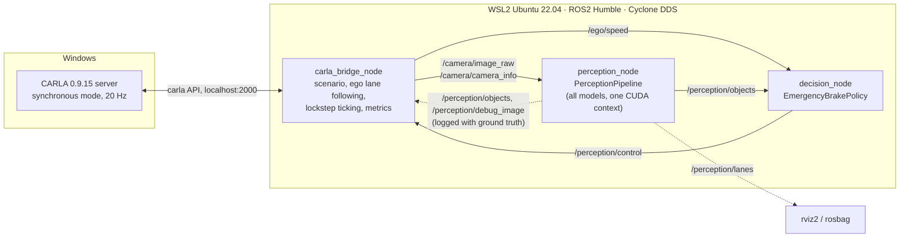
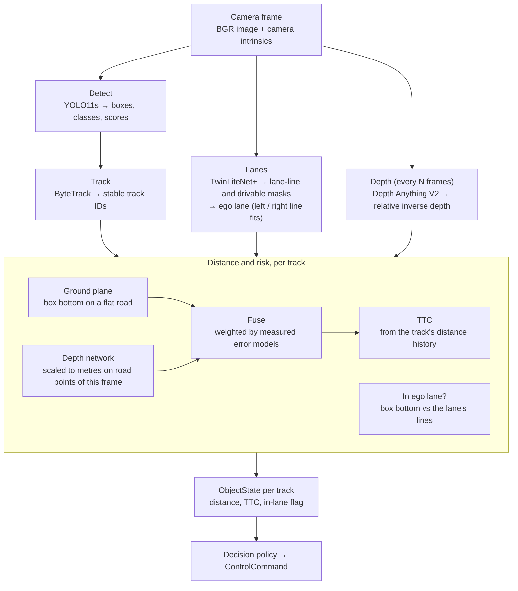
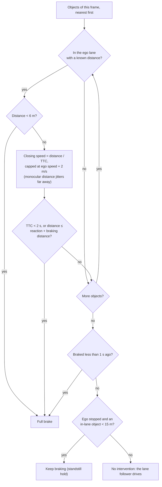
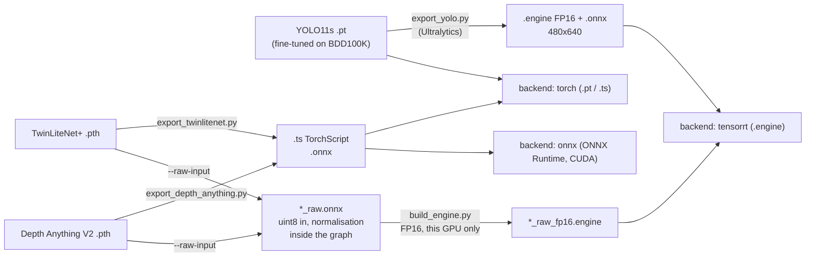

# Autonomous Driving Perception Stack

A camera-only perception stack for a self-driving car: it detects and tracks vehicles and pedestrians, finds the ego lane, estimates each object's distance and time to collision from a single camera, and brakes when something in the lane gets too close. The same pipeline runs offline on recorded frames and live in the CARLA simulator through ROS2, and runs at the camera's 20 Hz on a 6 GB laptop GPU with TensorRT.

- **Detection**: YOLO11s fine-tuned on BDD100K (9 classes, day and night)
- **Tracking**: ByteTrack, with an in-house DeepSORT for comparison
- **Lanes**: TwinLiteNet+ lane-line and drivable-area segmentation, with a classical OpenCV detector as baseline
- **Distance**: ground-plane geometry fused with Depth Anything V2 depth, calibrated on the road in every frame
- **Decision**: emergency braking on time to collision and stopping distance for objects in the ego lane
- **Deployment**: PyTorch, ONNX Runtime or TensorRT FP16 per model, chosen in config

## Architecture



- The core library (`src/perception/`) knows nothing about ROS, CARLA or W&B. Stages implement small interfaces (`Detector`, `Tracker`, `LaneDetector`, `DepthEstimator`, ...), register themselves, and are picked by config, so comparing ByteTrack with DeepSORT or PyTorch with TensorRT is a one-line override.
- All model stages run inside one ROS2 node to share a single CUDA context on the 6 GB GPU; the ROS nodes are thin adapters around the library.
- The bridge runs CARLA in lockstep: it publishes a frame, waits for the control command for that frame, applies it and only then advances the simulation. Slow perception costs wall-clock time but never changes what happens in the scenario.

### One frame through the pipeline

`PerceptionPipeline.process()` runs the stages in order and times each one. Every box is a config choice (shown: the closed-loop configuration).



### Closed loop in lockstep

The bridge advances CARLA only after the stack has answered the current frame, so the world waits for perception and every run is reproducible however slow the models or the renderer are.

```mermaid
sequenceDiagram
    autonumber
    participant C as CARLA server
    participant B as carla_bridge_node
    participant P as perception_node
    participant D as decision_node
    loop every simulation step (50 ms of simulated time)
        C-->>B: camera image of the current tick
        B->>P: /camera/image_raw, /camera/camera_info (stamp t)
        B->>D: /ego/speed
        P->>P: detect → track → lanes → depth → distance
        P->>D: /perception/objects (stamp t)
        P-->>B: /perception/objects, /perception/debug_image (for logs)
        D->>D: EmergencyBrakePolicy.decide()
        D->>B: /perception/control (stamp t)
        B->>B: lane follower steers; a brake command replaces throttle and brake
        B->>C: apply control, world.tick()
    end
    Note over B: ends on collision, a held stop, the end of the road or the time limit,<br/>then writes summary.json and ticks.csv
```

### Braking decision



Design details and trade-offs: [docs/DESIGN.md](docs/DESIGN.md). Data sources and processing: [docs/DATA.md](docs/DATA.md).

## Results

All numbers below were measured in this repository; the scripts that produce them are listed under [Usage](#usage).

### Closed loop in CARLA

The ego car drives at 30 km/h on a straight Town10 road; perception, distance and braking run on the live camera through ROS2.

| Scenario | First brake (true gap) | Stopped at | Outcome |
| --- | --- | --- | --- |
| Stopped car 50 m ahead | 17.6 m, TTC 2.0 s | 12.9 m | no collision |
| Pedestrian crossing into the lane | 15.9 m | 11.1 m | no collision; drives on once the person has crossed |
| Lead car brakes hard | 12.2 m | 8.7 m | no collision |
| Stopped car, braking disabled (baseline) | — | — | collision |

No false brakes in any run; peak GPU memory of the whole stack 528 MB.

### Detection (BDD100K val, 10,000 images)

| Model | mAP50 | mAP50-95 | mAP50 day | mAP50 night |
| --- | --- | --- | --- | --- |
| YOLO11s, COCO weights (7 shared classes) | 0.362 | 0.208 | 0.396 | 0.285 |
| YOLO11s fine-tuned, rare classes oversampled | **0.571** | **0.318** | 0.578 | 0.550 |
| YOLO11s fine-tuned, random subset | 0.543 | 0.300 | 0.549 | 0.528 |
| same, TensorRT FP16 engine | 0.544 | 0.298 | 0.550 | 0.526 |

Fine-tuning shrinks the night gap from 28 % to 5 % (mAP50). Oversampling images with riders, bicycles and motorcycles raises their AP50-95 by 26–27 % on BDD100K, but on CARLA it labels more pedestrians as riders, so the closed loop uses the random-subset model.

### Tracking (CARLA ground truth, 3 recordings, 1,785 frames)

| Tracker | MOTA | IDF1 | ID switches | Time per frame |
| --- | --- | --- | --- | --- |
| **ByteTrack** | **0.588** | **0.670** | **97** | ~2 ms |
| DeepSORT (ResNet18 appearance features) | 0.569 | 0.656 | 121 | 14–42 ms |

### Lanes

Ego-lane IoU against the drivable lane (BDD100K val, 2,000 images) and against an oracle ego lane built from CARLA's ground-truth road markings (1,200 frames):

| Detector | BDD100K | CARLA |
| --- | --- | --- |
| Classical (OpenCV, bird's-eye view) | 0.258 | 0.442 |
| TwinLiteNet+ Large | 0.755 | 0.748 |
| **TwinLiteNet+ Medium** | 0.736 | **0.753** |

### Distance (CARLA, 4 recordings, objects against their 3D boxes)

| Method | AbsRel, clean view of the road contact | AbsRel, contact occluded |
| --- | --- | --- |
| Ground plane (box bottom on a flat road) | 0.061 | 0.199 |
| Depth Anything V2, calibrated on the road per frame | 0.167 | 0.173 |
| **Fused** (weighted by measured errors) | 0.073 | 0.188 |

Dense depth error (AbsRel up to 80 m): MiDaS Small 0.405, Depth Anything V2 Small 0.092.

### TensorRT on the RTX 3050 (6 GB laptop GPU)

| Model | PyTorch FP32 | TensorRT FP16 | Speed-up | Output change |
| --- | --- | --- | --- | --- |
| YOLO11s (incl. pre/post-processing and NMS) | 28.7 ms | 6.4 ms | 4.7x | box F1 0.995 |
| TwinLiteNet+ Medium | 18.8 ms | 6.7 ms | 2.8x | mask IoU 0.999 |
| Depth Anything V2 Small (686x518) | 82.6 ms | 11.4 ms | 7.0x | 0.15 % |
| **Whole pipeline** | 139.5 ms (7.2 FPS) | **50.2 ms (19.9 FPS)** | 2.8x | mAP, lane IoU, distance error unchanged |

Median latency per call on CARLA frames. The lane and depth engines take the raw `uint8` camera image and normalise on the GPU. Pipeline time is per frame without writing the overlay video.

## Repository layout

```text
src/perception/        core library, independent of ROS / CARLA / W&B (installed with pip install -e .)
    core/                data contracts (types), stage interfaces, registry, config, timing
    backends/            inference backends: torch | onnx | tensorrt, raw-input export wrapper
    detection/ tracking/ lanes/ depth/ fusion/ planning/   stage implementations
    sim/                 CARLA simulator wrapper, scenarios, lane follower, closed-loop metrics
    io/ viz/ eval/       frame sources and sinks, overlays, evaluation metrics
    pipeline.py          PerceptionPipeline: runs the stages for one frame
ros2_ws/src/
    perception_msgs/     TrackedObject(Array), LaneInfo, ControlCommand
    perception_ros/      carla_bridge, perception, decision and player nodes; offline and CARLA launch files
configs/               pipeline/, lanes/, depth/, scenarios/, train/   (YAML, overridable as key=value)
scripts/               train, evaluate, export, build engines, benchmark, run the pipeline
data/                  BDD100K conversion scripts (the data itself is not committed)
carla_scripts/         connection test, recording sequences with ground truth
notebooks/             BDD100K EDA; Kaggle notebooks for CARLA recordings and closed-loop runs
tests/                 unit tests (CPU; GPU / CARLA ones marked)
docs/                  DESIGN.md, DATA.md
```

## Setup

Tested on Windows 11 with an RTX 3050 6 GB laptop GPU and 16 GB RAM. CARLA 0.9.15 runs natively on Windows; everything else (perception, ROS2 Humble, training, TensorRT) runs in WSL2 Ubuntu 22.04 and reaches CARLA on `localhost:2000`.

### 1. WSL2 and ROS2

```powershell
wsl --install -d Ubuntu-22.04
```

Mirrored networking lets WSL reach the Windows CARLA server on `localhost`. Add to `%UserProfile%\.wslconfig`, then run `wsl --shutdown`:

```ini
[wsl2]
networkingMode=mirrored
```

In Ubuntu, install ROS2 Humble ([guide](https://docs.ros.org/en/humble/Installation/Ubuntu-Install-Debs.html)) and Cyclone DDS, and select it in `~/.bashrc`:

```bash
sudo apt install ros-humble-desktop ros-humble-rmw-cyclonedds-cpp python3-colcon-common-extensions
echo 'export RMW_IMPLEMENTATION=rmw_cyclonedds_cpp' >> ~/.bashrc
```

The default Fast DDS hangs under mirrored networking. Don't set `ROS_LOCALHOST_ONLY=1`: the mirrored loopback can't multicast, and camera images (larger than one DDS fragment) are silently dropped.

### 2. Python environment (WSL)

Clone onto the Linux filesystem (`~/...`): git and file access under `/mnt/c` are about 100x slower.

```bash
git clone <repo url> ~/autonomous-driving-perception-stack && cd ~/autonomous-driving-perception-stack
python3 -m venv --system-site-packages .venv      # system site-packages: sees ROS2's rclpy
source .venv/bin/activate
pip config --site set global.keyring-provider disabled   # else pip hangs on Ubuntu's keyring over D-Bus
pip install -r requirements.txt                   # PyTorch (CUDA 12.4), Ultralytics, TensorRT 10, ...; installs this repo editable
pytest -m "not gpu and not carla"                 # CPU unit tests
pre-commit install
wandb login
```

### 3. ROS2 workspace

Build with ROS sourced and the venv **not** active:

```bash
source /opt/ros/humble/setup.bash
cd ros2_ws && colcon build --symlink-install && source install/setup.bash && cd ..
source .venv/bin/activate
pytest ros2_ws/src/perception_ros/test             # message conversions and nodes
```

### 4. CARLA (Windows)

Download [CARLA 0.9.15](https://github.com/carla-simulator/carla/releases) for Windows, start the server and check the connection from WSL:

```powershell
CarlaUE4.exe -quality-level=Low -windowed -ResX=800 -ResY=600
```

```bash
python carla_scripts/test_connection.py --host localhost --frames 10
```

CARLA, the perception models and ROS together need more than 16 GB of RAM. On such a machine the recordings and closed-loop runs can run on Kaggle instead (`notebooks/03_kaggle_carla_record.ipynb`, `notebooks/04_kaggle_carla_closed_loop.ipynb`): CARLA renders headless on the CPU while the models use the GPU, and synchronous mode makes the slow rendering cost only wall-clock time.

### 5. Models

From trained weights to what a stage loads. The backend is a config choice per stage, so the same pipeline runs on any row of the right-hand column:



Weights are not committed. Put them in `weights/`:

- **YOLO11s on BDD100K**: train it (below), or use the `detector` artifact logged to W&B by training.
- **TwinLiteNet+** and **Depth Anything V2 Small**: clone the authors' repositories and weights as described at the top of `scripts/export_twinlitenet.py` and `scripts/export_depth_anything.py`, then export to TorchScript and ONNX:

```bash
python scripts/export_twinlitenet.py --size medium --weights <medium.pth>
python scripts/export_depth_anything.py --kind relative --width 686 --height 518
```

- **TensorRT engines** (built per machine, as an engine is tied to its GPU and TensorRT version; each build takes a few minutes and up to ~6 GB of RAM, so build one at a time):

```bash
python scripts/export_yolo.py weights/yolo11s_bdd100k_random.pt          # .engine (FP16) + .onnx, 480x640
python scripts/export_twinlitenet.py --size medium --weights <medium.pth> --raw-input
python scripts/build_engine.py weights/twinlitenetplus_medium_raw.onnx
python scripts/export_depth_anything.py --kind relative --raw-input
python scripts/build_engine.py weights/depth_anything_v2_small_relative_686x518_raw.onnx
```

## Usage

Run from the repo root in WSL with the venv active (and ROS plus the workspace sourced for `ros2` commands). Any config key can be overridden on the command line as `key=value`.

### Data and training

```bash
python data/bdd100k_index.py            # BDD100K label JSONs -> parquet index (see docs/DATA.md for the download)
python data/bdd100k_to_yolo.py          # 20k-image training subset with rare classes oversampled (--no-oversample: random)
python scripts/train_detector.py --config configs/train/yolo11s_bdd100k.yaml
python carla_scripts/record_sequence.py --out data/carla/town10_noon_s0    # CARLA recording with ground truth
```

### Run the pipeline

```bash
# offline, writes an overlay video (boxes, IDs, lanes, distances, TTC) to runs/pipeline/
python scripts/run_pipeline.py data/carla/town10_noon_s0 --config configs/pipeline/carla_tensorrt.yaml
python scripts/run_pipeline.py clip.mp4 --config configs/pipeline/bdd100k.yaml --fov 60 tracker.type=deepsort

# through ROS2 on recorded frames, without the simulator
ros2 launch perception_ros offline.launch.py input:=data/carla/town10_noon_s0

# closed loop in CARLA (server running in the scenario's town); writes summary.json, ticks.csv and overlay frames
ros2 launch perception_ros carla.launch.py scenario:=configs/scenarios/pedestrian_crossing.yaml \
    config:=configs/pipeline/carla_tensorrt.yaml out_dir:=runs/closed_loop/pedestrian_crossing
ros2 launch perception_ros carla.launch.py scenario:=configs/scenarios/stopped_car.yaml \
    overrides:="policy.type=noop" out_dir:=runs/closed_loop/stopped_car_no_policy   # baseline without braking
```

### Evaluate and benchmark

```bash
python scripts/eval_detector.py --weights yolo11s_bdd100k.pt yolo11s_bdd100k_random.engine   # mAP all / day / night
python scripts/eval_tracking.py data/carla/town10_noon_s0 data/carla/town05_clearnoon_s2 --trackers bytetrack deepsort
python scripts/eval_lanes.py --config configs/lanes/segmentation_bdd100k.yaml                # BDD100K ego lane
python scripts/eval_lanes_carla.py data/carla/* --configs configs/lanes/segmentation_carla.yaml
python scripts/eval_distance.py data/carla/* --depth configs/depth/depth_anything_small_carla.yaml
python scripts/benchmark_backends.py data/carla/town10_noon_s0     # latency, GPU memory, output drift per backend
```

Every evaluation logs its config and results to Weights & Biases (`--no-wandb` to skip).

## Limitations

- In the closed-loop runs, monocular distance stays within about 5 % of the truth from 10 to 40 m. Further out it jitters by a few metres from frame to frame, so the braking policy caps the closing speed it trusts; under 10 m the box bottom leaves the image and distances read 5–15 % too far.
- The closed-loop scenarios are scripted on straight roads at 30 km/h without background traffic; curves, junctions and dense traffic are not covered.
- Tracking and distance are evaluated on CARLA only (the BDD100K release used here has no tracking labels), and CARLA's rendering is cleaner than real footage.
- The lane model was trained on 16:9 dashcam images; 4:3 frames are cropped to 16:9 before the network.
